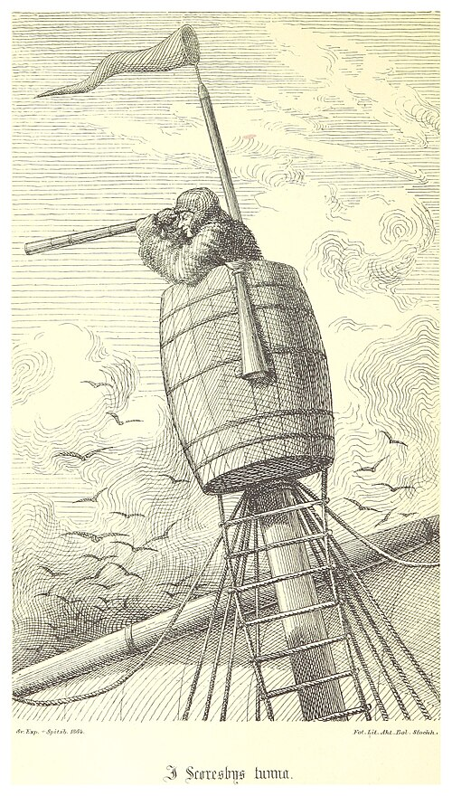

# mast

A terminal UI that shows every coding agent running on your machine and what
each one is doing.


Works with [Claude Code](https://claude.com/claude-code), [Codex](https://github.com/openai/codex)
and [pi](https://github.com/badlogic/pi-mono), wherever they run: any terminal, tmux pane or IDE.


<p>

<sub>A <a href="https://en.wikipedia.org/wiki/Mast_(sailing)">mast</a> holds the <a href="https://en.wikipedia.org/wiki/Crow%27s_nest">crow's nest</a>,
the lookout where you watch over everything at once. I thought about calling it crow's nest, but mast is easier to type.
(<a href="https://commons.wikimedia.org/wiki/File:(1867)_p184_I_SCORESBYS_TUNNA.jpg">Illustration</a>, 1867.)</sub>
</p>
<br clear="left">

## Install

With [Homebrew](https://brew.sh) on macOS or Linux:

```sh
brew install wu-json/asahi/mast
```

Or grab a binary from [Releases](https://github.com/wu-json/mast/releases),
or build from source:

```sh
cargo install --git https://github.com/wu-json/mast
```

## Usage

```sh
mast          # live view, q to quit
mast --once   # print a tab-separated snapshot and exit
```

While it runs, mast also sets your terminal's tab title, e.g. `⛵ mast · 1 needs you · 2 working`.

## How it works

mast finds agents in the process list (using the same name matching as
[herdr](https://herdr.dev)), then reads the session files each one already
writes under `~/.claude`, `~/.codex` and `~/.pi` to tell whether it's working,
idle or waiting on you.

It only reads files, so there's nothing to install into the agents. Custom
config directories set with `CLAUDE_CONFIG_DIR`, `CODEX_HOME` or
`PI_CODING_AGENT_DIR` are picked up.
